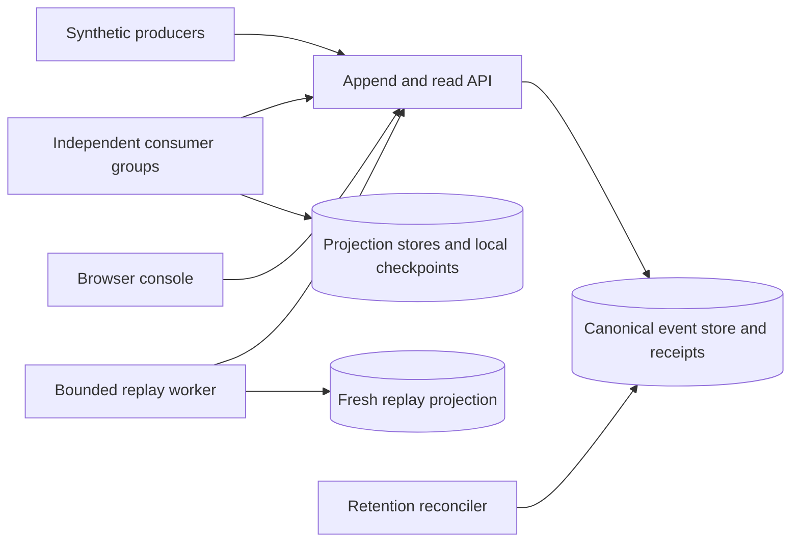

# Persistent Event Log and Replay Engine

Keep confirmed events in order, let independent consumers make progress, and rebuild a deterministic view from a clearly bounded replay. Make lag, missing retained ranges and interrupted work understandable in the browser.

**Stage:** requirements and design baseline, 20 November 2026. This repository contains the complete documentation project. The runtime engine has not been implemented; acceptance and performance results are NOT RUN.

Start with the [documentation guide](docs/README.md), [product requirements](docs/requirements/product.md), [high-level design](docs/architecture/high-level-design.md), and [component designs](docs/design/README.md).

The project includes software/quality requirements, API and data contracts, browser journeys, transaction protocols, state machines, security, operations, failure tests, acceptance traceability and delivery milestones. The supplied requirements are preserved [unchanged](docs/source/Persistent_Event_Log_and_Replay_Requirements.md).

Offsets are ordered within one stream generation. Canonical log acceptance and a consumer’s local projection are separate commits. Redelivery is expected; projection writes and their local checkpoint must be atomic.

The proposed reference stack is Python with a locally served browser interface and SQLite on local disk, subject to the permitted mirror and desktop verification gate. Runtime communication stays on loopback. No cloud, Docker or real private data is required.

Licensed under [MIT](LICENSE).

## Examples and schemas

See [worked examples](examples/README.md), [JSON Schemas](schemas/README.md), and the [reference database schema](schemas/reference-schema.sql).
