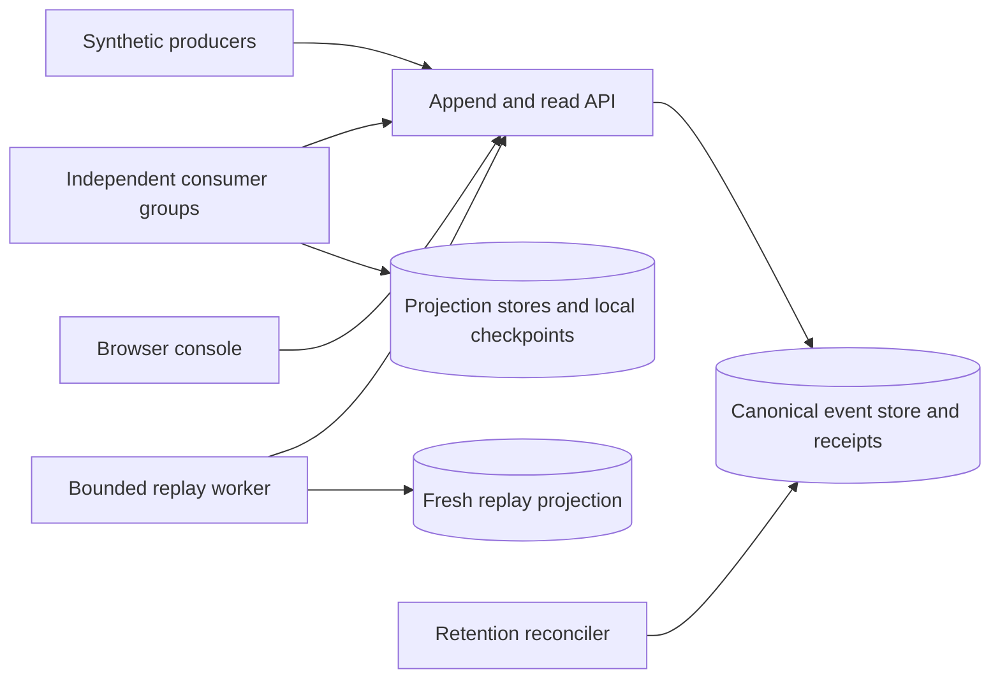

# High-level design

Keep confirmed events in order, let independent consumers make progress, and rebuild a deterministic view from a clearly bounded replay. Make lag, missing retained ranges and interrupted work understandable in the browser.

Offsets are ordered within one stream generation. Canonical log acceptance and a consumer’s local projection are separate commits. Redelivery is expected; projection writes and their local checkpoint must be atomic.

## System context and deployment



All runtime services run as ordinary local processes. The browser uses same-origin HTTP, locally bundled assets and no telemetry/CDN. Canonical storage sits on supported local disk outside synchronized folders. Separate consumer/replica stores remain separate correctness boundaries.

## End-to-end sequence

```mermaid
sequenceDiagram
    participant P as Producer
    participant L as Event service
    participant C as Consumer
    participant D as Projection store
    P->>L: Append batch with stable key
    L->>L: Commit events, segments, highWater and receipt
    L-->>P: Original accepted offset interval
    C->>L: Acquire epoch; fetch consecutive range
    L-->>C: Events and delivered end
    C->>D: Commit reducer writes, applied IDs and nextOffset
    C->>L: Fenced checkpoint commit with stable key
    L-->>C: Durable progress receipt
```

## Component responsibilities

| Component | Responsibility |
| --- | --- |
| [Atomic append and producer receipts](../design/append.md) | Validate ordered batch schemas and bounds before the write lock. |
| [Logical segments and integrity](../design/segments.md) | Assign consecutive records to one OPEN segment within record/byte thresholds. |
| [Consistent offset reads](../design/reads.md) | Validate stream generation, start offset, item/byte limits and optional replay bound. |
| [Group ownership and checkpoint fencing](../design/groups.md) | Acquire an ACTIVE group with a fresh instance and incremented epoch; reject current unexpired owner. |
| [Deterministic projections and recovery](../design/projections.md) | Verify source generation, reducer version and local nextOffset before processing. |
| [Replay and safe prefix retention](../design/replay-retention.md) | Capture endExclusive and create a fresh group/projection plus protected start atomically with replay creation. |
| Control API | Parse requests, enforce roles/revisions/keys, dispatch domain services, return durable outcomes |
| Browser | Explain authoritative state and pending intent without advancing progress locally |
| Storage | Enforce uniqueness, foreign keys, immutable history and atomic mutation boundaries |
| Failure harness | Control exact stop points and query committed-state invariants |

Read the [data model](../contracts/data-model.md), [API contract](../contracts/api.md) and [transaction protocol](../design/transactions.md) together. No in-memory queue, local UI state or process lock is the sole correctness mechanism.
