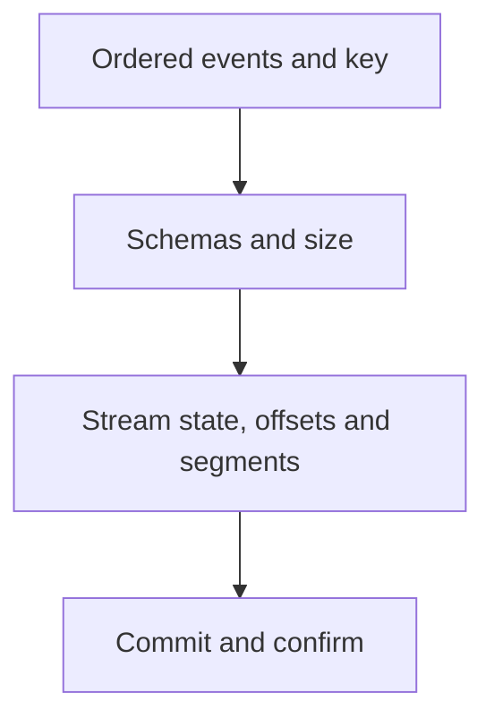

# Atomic append and producer receipts

Use half-open ranges throughout: accepted events occupy [start,end), and highWater is the next offset. A failed batch allocates no visible offsets. Receipt identity survives pruning and must not have a foreign key that forces deleted events to remain.

## Operation algorithm

1. Validate ordered batch schemas and bounds before the write lock.
2. Check producer/key receipt; a matching request returns the original interval even after retention.
3. Recheck stream generation, admission and capacity; reserve consecutive offsets and segment membership.
4. Commit events, highWater, audit and append receipt atomically before confirmation.

## Inputs outputs and ownership

The service receives a validated domain request, caller/process identity, target identity, expected revision or epoch where applicable, and stable operation key. Read authoritative mutable state inside the accepting transaction. Return the committed receipt/current bounded result, or a stable error without implying acceptance. Interfaces and fields are specified in the [API](../contracts/api.md) and [data model](../contracts/data-model.md).

## Atomicity and failure handling

Canonical append, group ownership/checkpoint and retention each serialize in the canonical store. Projection output and its own checkpoint commit separately in the consumer store. Never imply distributed atomicity between them.

Use conditional source-state checks, uniqueness constraints and atomic audit/receipt writes. On contention roll back and retry the entire operation under bounded backoff, preserving the key. On uncertain response consult the receipt before repeating work. A stale revision/epoch requires refresh or fresh authority, never a silently rewritten request. Database unavailability stops new confirmations.

## Detailed behavior inherited from the source

## Stream and event requirements

| ID | Requirement |
| --- | --- |
| STR-01 | Create a named stream with immutable ID/generation, capacity and versioned retention policy. Reject duplicate active names. |
| STR-02 | Events contain producer identity, producer request key, type/schema version, bounded payload, accepted time and content digest. |
| STR-03 | Append assigns consecutive offsets in transaction commit order. Rollback exposes neither record nor advanced highWater. |
| STR-04 | Events cannot be edited in place. Corrections are new events with explicit reference to prior events. |
| STR-05 | Pause admission rejects new appends while retained reads and consumer settlement continue. |
| STR-06 | First release has no automatic stream deletion/recreation. A name must not silently reset old offset/checkpoint identities. |

Each accepted stream declares supported payload schemas; validate event type/version at append. Old events retain their original schema. New schema versions require registered reducers compatible with those versions; unsupported events stop a projection explicitly instead of silently skipping.

## Atomic append and receipts

| ID | Requirement |
| --- | --- |
| APP-01 | One append operation targets one stream and contains 1 to 100 events, subject to a total request bound. The batch is all-or-nothing. |
| APP-02 | The producer supplies an operation key. Same key and canonical batch returns the same offset range; changed content conflicts. |
| APP-03 | Record inserts, segment membership, next offset, accepted event metadata and receipt commit in one transaction. |
| APP-04 | Confirmation is returned only after the store reports durable commit using the selected durability configuration. |
| APP-05 | Producer receipts survive segment retention so an old key cannot create a second accepted batch. Replays may reference offsets already retained away. |
| APP-06 | Capacity failure rejects the batch. If retention is blocked, return backpressure rather than deleting protected records. |
| APP-07 | Validate serialization, sizes and schemas before acquiring a write transaction, then recheck mutable stream state inside it. |

Default payload maximum is 64 KiB, batch maximum 1 MiB encoded, metadata maximum 8 KiB per event. Reject duplicate JSON keys, nonfinite numbers and ambiguous encodings. Define canonical bytes/digest algorithm once. The request digest includes stream generation, event order, types, versions and payloads. Store individual event digests too.

## Verification boundary

Exercise each applicable acceptance row linked in [traceability](../requirements/traceability.md). Test both serialized race orders, rollback before commit and response loss after commit. Assertions inspect committed state and immutable receipts; browser messages and process logs alone are insufficient evidence.
