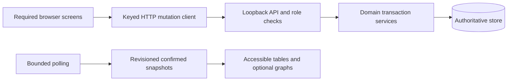

# Browser and control API design

Routes parse strict bounded input, validate a disposable fictional role, check Origin/Host, and call the domain service. They do not contain a second implementation of state transitions. Server-side role checks remain mandatory when a UI hides a control. No arbitrary handler/reducer code, URLs or paths enter the runtime.

Maintain loading, empty, disconnected, stale, forbidden, failed and pending-action states. Healthy visible views poll at a proposed one-second interval; back off disconnected reads without changing durable progress. Ignore older revisions arriving late. Persist mutation intent/key across an uncertain response and reuse it; revisions/decisions that conflict require explicit refresh and reconsideration.

Use escaped text, keyboard navigation, visible text statuses, focus-managed dialogs and complete table equivalents. The following screen contracts remain mandatory.

## Browser workspace

Screens: stream list and creation; synthetic append; event explorer with offset navigation; segment/integrity view; consumer-group lag and ownership; bounded replay controls; projection comparison; retention preview/blockers; audit and readiness.

Always distinguish highWater from consumer nextOffset and completed replay from partial output. Show retained interval, epoch, pending action and unsupported reducer/schema errors. Explain retention consequences before group retirement or deletion. Refresh does not reset progress. Two tabs use expected revisions and show conflicts. Provide keyboard operation, text status labels and tables equivalent to charts. Bundle all assets locally.

API list defaults are 50/maximum 200 unless a specialized read/feed contract specifies other bounds. Return stable error code, human-readable message, bounded field details and correlation ID. See the [complete API](../contracts/api.md) for operation-specific limits and range/conflict behavior.
