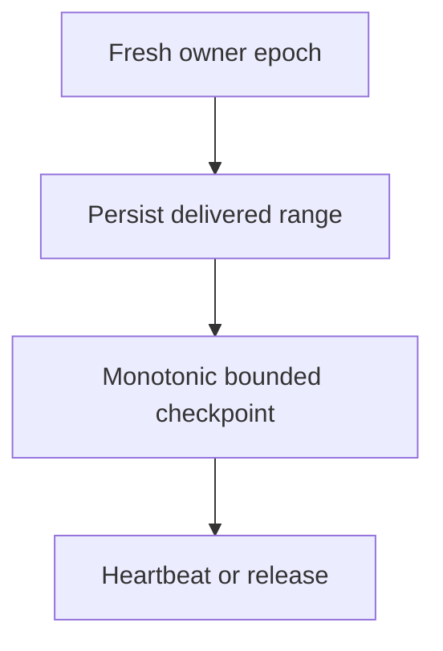

# Group ownership and checkpoint fencing

Track delivered range for this epoch, not a global maximum from a previous owner. A known empty poll uses a new key next time; uncertain transport retries keep their key. PAUSED groups continue pinning retention; RETIRED is irreversible and releases protection.

## Operation algorithm

1. Acquire an ACTIVE group with a fresh instance and incremented epoch; reject current unexpired owner.
2. Fetch under current lease and persist the owner’s contiguous delivered range.
3. Commit only monotonic nextOffset no greater than deliveredEndExclusive.
4. Pause/retire revokes ownership; keyed committed checkpoint replay returns old proof without granting authority.

## Inputs outputs and ownership

The service receives a validated domain request, caller/process identity, target identity, expected revision or epoch where applicable, and stable operation key. Read authoritative mutable state inside the accepting transaction. Return the committed receipt/current bounded result, or a stable error without implying acceptance. Interfaces and fields are specified in the [API](../contracts/api.md) and [data model](../contracts/data-model.md).

## Atomicity and failure handling

Canonical append, group ownership/checkpoint and retention each serialize in the canonical store. Projection output and its own checkpoint commit separately in the consumer store. Never imply distributed atomicity between them.

Use conditional source-state checks, uniqueness constraints and atomic audit/receipt writes. On contention roll back and retry the entire operation under bounded backoff, preserving the key. On uncertain response consult the receipt before repeating work. A stale revision/epoch requires refresh or fresh authority, never a silently rewritten request. Database unavailability stops new confirmations.

## Required behavior

## Consumer groups and ownership

| ID | Requirement |
| --- | --- |
| CON-01 | Create a named group bound to one stream generation and initial nextOffset within the retained range. |
| CON-02 | Only one local consumer instance owns a group at a time. Acquire ownership atomically and increment owner epoch. |
| CON-03 | Default ownership lease is 15 seconds with heartbeat every 5 seconds. Expired ownership cannot be revived. |
| CON-04 | Fetch/commit carries group ID, instance ID and epoch; stale owners cannot advance progress. |
| CON-05 | Track the current owner's contiguous delivered range. A commit cannot exceed deliveredEndExclusive or move the checkpoint backward. |
| CON-06 | A committed checkpoint means the client asserts processing through that range. The server cannot prove arbitrary consumer effects occurred. |
| CON-07 | Idle or stopped durable groups continue to pin retention until explicitly retired. Show that cost in the UI. |
| CON-08 | Group retirement is explicit, revision-checked and irreversible in this release; it releases retention protection and revokes ownership. |
| CON-09 | Operator pause/resume uses expected group revision. Pause revokes the current owner epoch and blocks new acquisition/fetch; its checkpoint still protects retention. Resume permits a fresh epoch without resetting progress. |

Transport retries preserve operation keys. A matching committed checkpoint receipt can be replayed after lease expiry; that proves past progress and grants no current ownership. Empty fetches and heartbeats have documented key lifetimes. Counted checkpoints and lease updates come from committed state, never process memory alone.

Group control state is ACTIVE, PAUSED or RETIRED. If a consumer finishes a local projection batch after group pause, its now-stale server checkpoint commit is rejected. On resume, normal idempotent projection recovery reconciles that already committed local output before advancing server progress.

## Transaction and recovery protocol

Document isolation, lock ordering and linearization for append, owner acquisition, checkpoint commit, retention and replay control. Recheck stream/group revision, owner epoch and durable time within the accepting transaction. Shared limits and metadata must be protected as well as the selected row.

On startup verify schema compatibility, consistency of highWater/segments, due owner expiry and replay status. Do not reset checkpoints or grant old ownership fresh leases. Several reconciliation loops must be safe through conditional updates and unique constraints.

When storage is unavailable, stop confirmations and progress commits. Handle uncertain commit results through durable keyed receipts. Graceful producers finish current append; graceful consumers finish bounded batches and release ownership. Hard stops recover through lease expiry and retained checkpoints. A recovery scan verifies segment boundaries/digests without rewriting history to hide damage.

## Verification boundary

Exercise each applicable acceptance row linked in [traceability](../requirements/traceability.md). Test both serialized race orders, rollback before commit and response loss after commit. Assertions inspect committed state and immutable receipts; browser messages and process logs alone are insufficient evidence.
