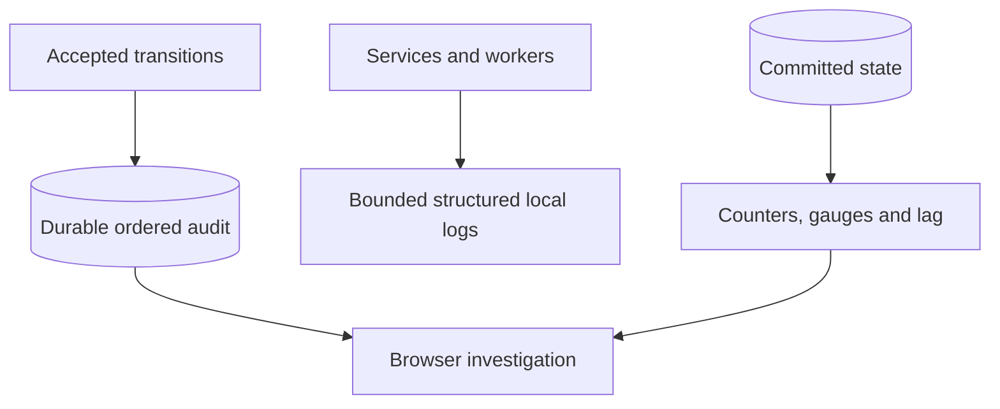

# Observability and diagnosis

Every diagnostic includes correlation ID and applicable stream/queue/replica, operation, record/event/entry and process identity. Audit is transactional evidence; process logs and metrics help explain behavior. Redact tokens and never log arbitrary full payloads by default. Heartbeats need no individual audit event.

Liveness means the process responds. Readiness requires supported schema, storage access, configuration and integrity checks. An unavailable store returns explicit not-ready and stops confirmation. Show the exact blocking reason, retained bounds/lag or pending authority so an operator can choose a safe action.

## Access observability and operations

Loopback binding, strict same-origin mutation checks and disposable fictional operator/producer/consumer roles are required. No real account sign-in, real secrets, external URLs or arbitrary input paths. Allowlisted fixtures/reducers only; fault controls are disabled in normal mode. Bound JSON nesting, payloads, logs and inspection responses.

Metrics: append latency/rate, high/low watermarks, retained bytes, group lag, owner expiry, stale-epoch rejection, replay progress, retention blockers and integrity failures. Audit committed append, ownership, checkpoint, replay and retention transitions in transaction order. Avoid an audit record per heartbeat when it would create unbounded noise.

Use explicit checksummed migrations and consistent store snapshots including receipts and retention metadata. For end-to-end projection restore, stop relevant processes and take a coordinated cold snapshot of canonical and projection stores, or document a tested independent-recovery protocol. Do not assume separately timed live copies are consistent. Restore with fresh process identities and original checkpoints. Keep actual evidence reports separate from regenerable templates.

## Provisional targets

Initial measurable targets: 10 streams; 100,000 retained small events; 10 independent groups; four concurrent consumers across groups; 1,000-event/8 MiB logical segments; 100 small events per second over 60 seconds; p95 bounded reads below 500 ms; ownership expiry reconsidered within 5 seconds of deadline; UI convergence within 3 seconds; under 2 GiB service/store RAM excluding browser/build. A 30-minute soak must show no steadily growing leak or permanently stranded eligible consumer.

Record environment, payload sizes, store settings, group count and exact workload. These are proposals, not existing measurements. Retention pressure and slow reducers must be measured separately from raw append throughput.

Keep metrics labels bounded; individual IDs belong in drill-down views rather than unlimited time-series labels. Preserve actual measurements and failures separately from report templates.
