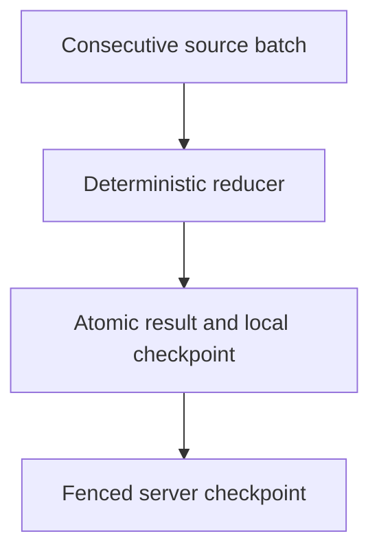

# Deterministic projections and recovery

Applied identity is stream generation plus offset and projection identity. Already applied records verify matching digest and become no-ops. Unsupported schema or invalid business history rolls back the batch and records a diagnostic outside that failed projection transaction; it never skips the event.

## Operation algorithm

1. Verify source generation, reducer version and local nextOffset before processing.
2. Apply one consecutive batch with reducer writes, applied-event guards and checkpoint in one projection transaction.
3. Only after local commit request the canonical group checkpoint.
4. On restart reconcile server-behind-local by safe reread; server-ahead-local is an error requiring investigation.

## Inputs outputs and ownership

The service receives a validated domain request, caller/process identity, target identity, expected revision or epoch where applicable, and stable operation key. Read authoritative mutable state inside the accepting transaction. Return the committed receipt/current bounded result, or a stable error without implying acceptance. Interfaces and fields are specified in the [API](../contracts/api.md) and [data model](../contracts/data-model.md).

## Atomicity and failure handling

Canonical append, group ownership/checkpoint and retention each serialize in the canonical store. Projection output and its own checkpoint commit separately in the consumer store. Never imply distributed atomicity between them.

Use conditional source-state checks, uniqueness constraints and atomic audit/receipt writes. On contention roll back and retry the entire operation under bounded backoff, preserving the key. On uncertain response consult the receipt before repeating work. A stale revision/epoch requires refresh or fresh authority, never a silently rewritten request. Database unavailability stops new confirmations.

## Detailed behavior inherited from the source

## Projection consumer and replay correctness

The built-in reducer reads batches sequentially and commits all derived writes, an applied-event identity guard and its nextOffset in one local projection transaction. If a batch fails, roll it back completely. Use deterministic integer/string operations and stable serialization for expected hashes; avoid wall-clock or random values in canonical results.

Only after local projection commit does the consumer ask the service to advance the group checkpoint. If that response is lost, retry the same key. If server progress lags the local projection after restart, reread from the server checkpoint and recognize already applied offsets without repeating effects, then advance safely. Server progress ahead of the local projection is a consistency error requiring investigation, not permission to skip data.

Projection storage may be separate from broker storage; do not claim one atomic transaction spans them. Independent replay uses a fresh group and projection ID, preserving the original group's checkpoint. Replay state is CREATED, RUNNING, PAUSED, SUCCEEDED, FAILED or CANCELLED. Cancellation stops future batches; already committed projection batches remain inspectable. Whole-stream record replay is not arbitrary program execution.

## Verification boundary

Exercise each applicable acceptance row linked in [traceability](../requirements/traceability.md). Test both serialized race orders, rollback before commit and response loss after commit. Assertions inspect committed state and immutable receipts; browser messages and process logs alone are insufficient evidence.
