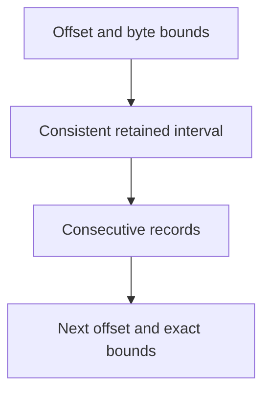

# Consistent offset reads

Default reads are 100 events, maximum 1,000 and 1 MiB. Do not split a JSON record to satisfy bytes; return fewer records. Offset 0 is valid only while retained. Payload timestamps never reorder the log.

## Operation algorithm

1. Validate stream generation, start offset, item/byte limits and optional replay bound.
2. Read lowWater, highWater and the requested consecutive records in one snapshot.
3. Return explicit unchanged nextOffset at highWater; reject offsets outside retained bounds.
4. Validate event digests and return nextOffset equal to the end of the complete returned range.

## Inputs outputs and ownership

The service receives a validated domain request, caller/process identity, target identity, expected revision or epoch where applicable, and stable operation key. Read authoritative mutable state inside the accepting transaction. Return the committed receipt/current bounded result, or a stable error without implying acceptance. Interfaces and fields are specified in the [API](../contracts/api.md) and [data model](../contracts/data-model.md).

## Atomicity and failure handling

Canonical append, group ownership/checkpoint and retention each serialize in the canonical store. Projection output and its own checkpoint commit separately in the consumer store. Never imply distributed atomicity between them.

Use conditional source-state checks, uniqueness constraints and atomic audit/receipt writes. On contention roll back and retry the entire operation under bounded backoff, preserving the key. On uncertain response consult the receipt before repeating work. A stale revision/epoch requires refresh or fresh authority, never a silently rewritten request. Database unavailability stops new confirmations.

## Required behavior

## Read contract

Reads specify stream ID/generation, start offset, maximum events and maximum response bytes. Return consecutive records in offset order with nextOffset, lowWater, highWater and relevant digests. Default page is 100 events, maximum 1,000, bounded by 1 MiB response bytes.

At highWater return an explicit empty result with unchanged nextOffset. Requests below lowWater return OFFSET_OUT_OF_RANGE with current bounds; do not silently fast-forward. Requests above highWater are rejected. A page is read from one consistent snapshot and cannot combine a deleted segment boundary with stale metadata.

A read need not commit group progress. Bounded replay reads also carry endExclusive, captured at replay creation, and never consume later appends. Polling rather than a streaming socket is acceptable. Business-event timestamps can be searched, but only an explicit resulting offset controls replay.

## Verification boundary

Exercise each applicable acceptance row linked in [traceability](../requirements/traceability.md). Test both serialized race orders, rollback before commit and response loss after commit. Assertions inspect committed state and immutable receipts; browser messages and process logs alone are insufficient evidence.
