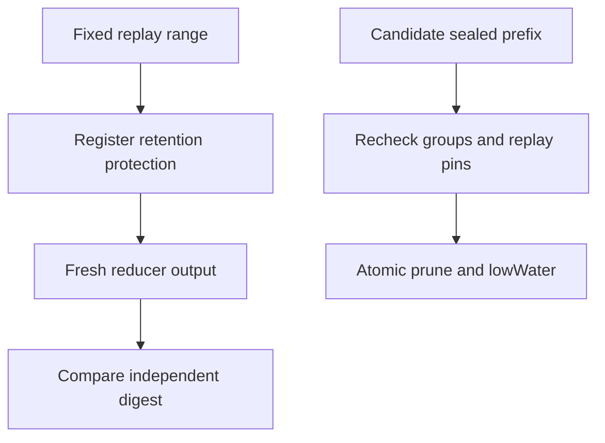

# Replay and safe prefix retention

Retention preview is advisory; never trust its cutoff without revalidation. Explicitly define protection release for terminal replay states; proposed baseline retains failed/paused replay protection until cancellation or explicit retirement, favoring inspectable recovery. Receipts and audit are excluded from pruning.

## Operation algorithm

1. Capture endExclusive and create a fresh group/projection plus protected start atomically with replay creation.
2. Run only within [start,endExclusive), preserving partial output on pause/cancel.
3. Preview retention using SEALED prefix policy, all durable group checkpoints and active replay protection.
4. Inside apply transaction recompute blockers, delete only the safe sealed prefix, advance lowWater and audit.

## Inputs outputs and ownership

The service receives a validated domain request, caller/process identity, target identity, expected revision or epoch where applicable, and stable operation key. Read authoritative mutable state inside the accepting transaction. Return the committed receipt/current bounded result, or a stable error without implying acceptance. Interfaces and fields are specified in the [API](../contracts/api.md) and [data model](../contracts/data-model.md).

## Atomicity and failure handling

Canonical append, group ownership/checkpoint and retention each serialize in the canonical store. Projection output and its own checkpoint commit separately in the consumer store. Never imply distributed atomicity between them.

Use conditional source-state checks, uniqueness constraints and atomic audit/receipt writes. On contention roll back and retry the entire operation under bounded backoff, preserving the key. On uncertain response consult the receipt before repeating work. A stale revision/epoch requires refresh or fresh authority, never a silently rewritten request. Database unavailability stops new confirmations.

## Required behavior

## Projection consumer and replay correctness

The built-in reducer reads batches sequentially and commits all derived writes, an applied-event identity guard and its nextOffset in one local projection transaction. If a batch fails, roll it back completely. Use deterministic integer/string operations and stable serialization for expected hashes; avoid wall-clock or random values in canonical results.

Only after local projection commit does the consumer ask the service to advance the group checkpoint. If that response is lost, retry the same key. If server progress lags the local projection after restart, reread from the server checkpoint and recognize already applied offsets without repeating effects, then advance safely. Server progress ahead of the local projection is a consistency error requiring investigation, not permission to skip data.

Projection storage may be separate from broker storage; do not claim one atomic transaction spans them. Independent replay uses a fresh group and projection ID, preserving the original group's checkpoint. Replay state is CREATED, RUNNING, PAUSED, SUCCEEDED, FAILED or CANCELLED. Cancellation stops future batches; already committed projection batches remain inspectable. Whole-stream record replay is not arbitrary program execution.

## Retention and backpressure

Retention deletes only a contiguous prefix of SEALED segments. The proposed cutoff must satisfy age/size policy and be no greater than every active durable group's checkpoint and every active replay's protected start. Never delete the OPEN segment or skip a protected segment to delete later ones.

Baseline canonical records and metadata are in one transactional store, so prefix deletion and lowWater advancement commit together. Producer receipts and audit remain retained. Reads and retention use snapshot/transaction rules preventing inconsistent bounds. Custom file deletion would need a separate crash-safe deletion protocol and is deferred.

Paused or failed consumers can block deletion. Show the blocking group and storage pressure. At the configured hard cap, reject appends until safe capacity becomes available; do not discard unprocessed data. Registering a new group never resurrects already deleted data. First release has no snapshots for replay from a pruned prefix: clients need a retained baseline or must receive a clear unavailable-range error.

## Verification boundary

Exercise each applicable acceptance row linked in [traceability](../requirements/traceability.md). Test both serialized race orders, rollback before commit and response loss after commit. Assertions inspect committed state and immutable receipts; browser messages and process logs alone are insufficient evidence.
