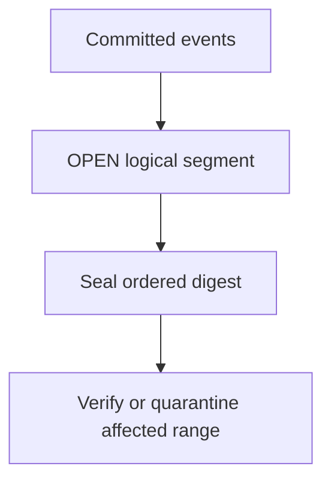

# Logical segments and integrity

The initial limits are 1,000 records or 8 MiB. Define threshold handling before append so an event never straddles segments. One batch may rotate multiple logical segments inside its transaction. These are indexed database groupings, not a custom physical log-file recovery protocol.

## Operation algorithm

1. Assign consecutive records to one OPEN segment within record/byte thresholds.
2. Before a successor starts, seal the old segment with immutable bounds, count and ordered-content digest.
3. Verify per-event digests and sealed segment digests on startup and bounded investigation.
4. Mark affected reads unavailable on mismatch and preserve evidence; do not silently rebuild damaged data.

## Inputs outputs and ownership

The service receives a validated domain request, caller/process identity, target identity, expected revision or epoch where applicable, and stable operation key. Read authoritative mutable state inside the accepting transaction. Return the committed receipt/current bounded result, or a stable error without implying acceptance. Interfaces and fields are specified in the [API](../contracts/api.md) and [data model](../contracts/data-model.md).

## Atomicity and failure handling

Canonical append, group ownership/checkpoint and retention each serialize in the canonical store. Projection output and its own checkpoint commit separately in the consumer store. Never imply distributed atomicity between them.

Use conditional source-state checks, uniqueness constraints and atomic audit/receipt writes. On contention roll back and retry the entire operation under bounded backoff, preserving the key. On uncertain response consult the receipt before repeating work. A stale revision/epoch requires refresh or fresh authority, never a silently rewritten request. Database unavailability stops new confirmations.

## Required behavior

## Logical segments integrity and indexes

Assign events to logical segments with configurable record/byte thresholds, initially 1,000 records or 8 MiB. A segment owns a contiguous offset interval. Seal before starting its successor; sealing records the immutable interval, count and digest over ordered event identity and canonical content. Persist an empty current segment only if the format explicitly supports it.

Sealed segment digest verification must detect altered/reordered/missing content. This verifies retained application records, not the underlying disk's correctness. An OPEN segment has individually verified records and can be sealed during recovery or clean shutdown. Transaction rollback prevents partially accepted records from becoming visible.

Index stream/offset, event key/type where required, group checkpoint, owner expiry and segment bounds. The authoritative data is committed records; rebuild optional indexes from that data in a controlled operation. Never silently discard a damaged sealed segment. Mark the stream unavailable for affected reads, preserve evidence and offer restore instructions.

## Transaction and recovery protocol

Document isolation, lock ordering and linearization for append, owner acquisition, checkpoint commit, retention and replay control. Recheck stream/group revision, owner epoch and durable time within the accepting transaction. Shared limits and metadata must be protected as well as the selected row.

On startup verify schema compatibility, consistency of highWater/segments, due owner expiry and replay status. Do not reset checkpoints or grant old ownership fresh leases. Several reconciliation loops must be safe through conditional updates and unique constraints.

When storage is unavailable, stop confirmations and progress commits. Handle uncertain commit results through durable keyed receipts. Graceful producers finish current append; graceful consumers finish bounded batches and release ownership. Hard stops recover through lease expiry and retained checkpoints. A recovery scan verifies segment boundaries/digests without rewriting history to hide damage.

## Verification boundary

Exercise each applicable acceptance row linked in [traceability](../requirements/traceability.md). Test both serialized race orders, rollback before commit and response loss after commit. Assertions inspect committed state and immutable receipts; browser messages and process logs alone are insufficient evidence.
