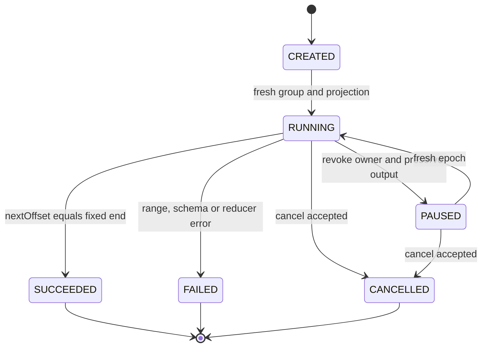

# State machines and control races

Terminal outcomes do not reopen. Idempotent replay returns an existing receipt; it does not repeat a transition. Controls use expected revisions, persisted state and the transaction protocol.

Offsets are ordered within one stream generation. Canonical log acceptance and a consumer’s local projection are separate commits. Redelivery is expected; projection writes and their local checkpoint must be atomic.

## Race matrix

| Race | Required result |
| --- | --- |
| New mutation versus matching retry | Return one original outcome; changed content conflicts |
| Current owner versus replacement | Epoch/generation determines authority; stale update rejected |
| Control versus new work | First valid serialized transition determines admission |
| Completion versus deadline | Check durable time inside writer; expired authority cannot make a new commit |
| Read versus retention/snapshot transition | Return one consistent state and bounds or an explicit error |
| Commit versus lost response | Replay receipt; do not infer rollback from transport failure |

The component documents supply additional source state values and exact transitions. Each race must be tested in both orders using deterministic barriers.
