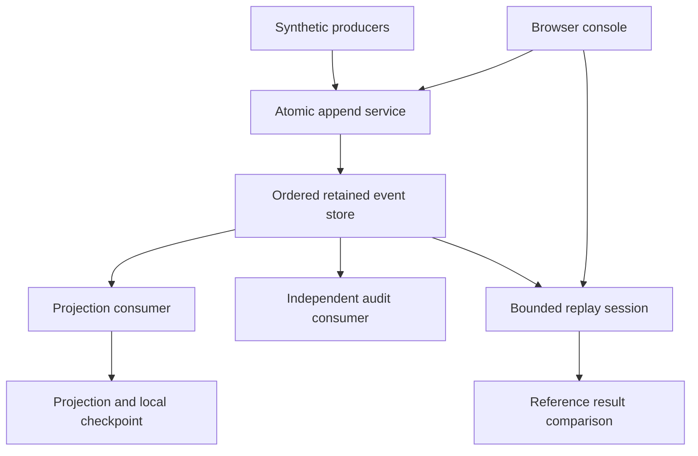

# Product requirements and scope

Keep confirmed events in order, let independent consumers make progress, and rebuild a deterministic view from a clearly bounded replay. Make lag, missing retained ranges and interrupted work understandable in the browser.

## Purpose and release outcome

Build a local append-only event service with durable publish receipts, ordered stream offsets, independent consumer positions and repeatable replay. A browser workspace exposes streams, retained ranges, consumer lag, replay sessions, derived projections and recovery history.

The intended outcome is an end-to-end demonstration that confirmed events remain available after process restart, consumers recover from committed checkpoints, and replay reconstructs a deterministic result. This is a bounded one-machine project, not Kafka compatibility, cluster replication or a production streaming platform.

This document proposes requirements and targets. It supplies no implementation evidence and no programme approval. Participant ownership, permitted inputs and independent project-origin requirements must be resolved separately.

## Users and concrete example

| User | Need |
| --- | --- |
| Producer developer | Append events and resolve uncertain responses without duplicating accepted records. |
| Consumer developer | Process events in order, commit progress and recover after a stop. |
| Operator | See lag, blocked consumers, retention boundaries and replay progress. |
| Investigator | Rebuild a local projection and compare it with a known reference. |

Use a fictional device-state stream containing created, reading-recorded, label-changed and retired events. IDs describe synthetic devices and never actual people or machines. Independent consumers build a current-device view and summary counters. A replay consumer rebuilds those views from a known retained starting point.

## Desktop constraints and implementation freedom

Everything runs on one machine with loopback communication, local storage and a locally served browser interface. No internet, Docker, GPU, sound, cloud account, external Kafka broker, native desktop toolkit or production system is required. All dependencies must be available through the supplied mirror before the stack is chosen.

Requirements are language agnostic. Select one transactional local store for canonical event records, metadata and producer receipts in the baseline. Logical storage segments group records for indexing, checksums and retention. A custom physical log-file format is optional later work, not a hidden prerequisite. Do not claim to have implemented a storage engine's power-loss recovery merely by using its transactions.

## Scope

Required: named streams, immutable events, monotonic offsets, keyed append, logical segment sealing and digests, bounded reads, durable consumer groups, lease/epoch fencing, checkpoint commits, separate replay sessions, database-contained projections, safe prefix retention, diagnostics, audit and browser operation.

Deferred: multiple partitions inside a stream, cross-stream atomic append, cross-machine replication, consensus, Kafka wire compatibility, stream joins, event-time windows, arbitrary code execution, cloud sinks, schema migration of existing payloads, compaction, indefinite archival and AI infrastructure. Parallelism comes from multiple streams and independent groups; one group has one authorized owner at a time.

## Terms and delivery semantics

| Term | Meaning |
| --- | --- |
| Stream | An ordered sequence with a stable ID and generation. |
| Offset | Zero-based integer assigned transactionally to a committed event. |
| highWater | Next offset after the final committed record. |
| lowWater | First retained offset. Valid records lie in [lowWater, highWater). |
| Segment | Consecutive logical record group, OPEN or SEALED, with bounds and digest. |
| Group checkpoint | Next offset that a named consumer group needs to process. |
| Owner epoch | Generation authorizing one current group consumer. |
| Replay session | Independent bounded read/projection run with its own group/projection identity. |
| Projection | Local derived state plus next-offset checkpoint committed in the same consumer database transaction. |

Append confirmation proves durable acceptance in the canonical store under its documented assumptions. Consumer delivery is at least once: output may commit before the server learns the checkpoint. Demonstration projections deduplicate and commit output plus their own checkpoint atomically. That does not prove exactly-once arbitrary external effects.

Ordering is within a stream only. Event payload timestamps are data; they do not reorder accepted events. Cross-stream ordering is unspecified. A crashed unacknowledged append may have committed; a keyed retry discovers that outcome.

## Reference journey

Generate 20,000 deterministic events with valid per-device histories and a recorded seed. Precompute final projections using an independent simple reference reducer. Append events in the fixture's defined sequence. Start two independent groups; pause one and show its lag. Kill a consumer between projection commit and broker checkpoint acknowledgement, restart, and verify safe redelivery.

Start a separate replay group and fresh projection database at offset 0 before retention removes that prefix. Fix its end-exclusive bound at the captured highWater so new appends do not change the replay input. Compare canonical projection hashes. A second fixture exercises deliberate gaps in device business history as invalid domain data without corrupting stream ordering.

