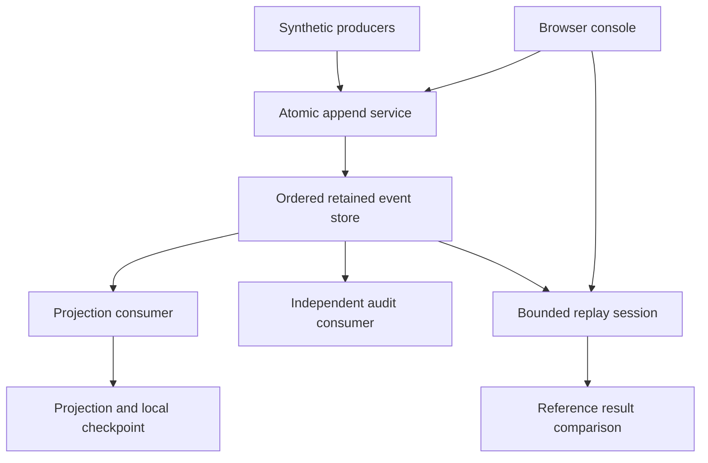

# Persistent Event Log and Replay Engine Requirements

Version 0.1 | 20 November 2026 | Language agnostic | Proposed first release

## 1 Purpose and release outcome

Build a local append-only event service with durable publish receipts, ordered stream offsets, independent consumer positions and repeatable replay. A browser workspace exposes streams, retained ranges, consumer lag, replay sessions, derived projections and recovery history.

The intended outcome is an end-to-end demonstration that confirmed events remain available after process restart, consumers recover from committed checkpoints, and replay reconstructs a deterministic result. This is a bounded one-machine project, not Kafka compatibility, cluster replication or a production streaming platform.

This document proposes requirements and targets. It supplies no implementation evidence and no programme approval. Participant ownership, permitted inputs and independent project-origin requirements must be resolved separately.

## 2 Users and concrete example

| User | Need |
| --- | --- |
| Producer developer | Append events and resolve uncertain responses without duplicating accepted records. |
| Consumer developer | Process events in order, commit progress and recover after a stop. |
| Operator | See lag, blocked consumers, retention boundaries and replay progress. |
| Investigator | Rebuild a local projection and compare it with a known reference. |

Use a fictional device-state stream containing created, reading-recorded, label-changed and retired events. IDs describe synthetic devices and never actual people or machines. Independent consumers build a current-device view and summary counters. A replay consumer rebuilds those views from a known retained starting point.

## 3 Desktop constraints and implementation freedom

Everything runs on one machine with loopback communication, local storage and a locally served browser interface. No internet, Docker, GPU, sound, cloud account, external Kafka broker, native desktop toolkit or production system is required. All dependencies must be available through the supplied mirror before the stack is chosen.

Requirements are language agnostic. Select one transactional local store for canonical event records, metadata and producer receipts in the baseline. Logical storage segments group records for indexing, checksums and retention. A custom physical log-file format is optional later work, not a hidden prerequisite. Do not claim to have implemented a storage engine's power-loss recovery merely by using its transactions.

## 4 Scope

Required: named streams, immutable events, monotonic offsets, keyed append, logical segment sealing and digests, bounded reads, durable consumer groups, lease/epoch fencing, checkpoint commits, separate replay sessions, database-contained projections, safe prefix retention, diagnostics, audit and browser operation.

Deferred: multiple partitions inside a stream, cross-stream atomic append, cross-machine replication, consensus, Kafka wire compatibility, stream joins, event-time windows, arbitrary code execution, cloud sinks, schema migration of existing payloads, compaction, indefinite archival and AI infrastructure. Parallelism comes from multiple streams and independent groups; one group has one authorized owner at a time.

## 5 Terms and delivery semantics

| Term | Meaning |
| --- | --- |
| Stream | An ordered sequence with a stable ID and generation. |
| Offset | Zero-based integer assigned transactionally to a committed event. |
| highWater | Next offset after the final committed record. |
| lowWater | First retained offset. Valid records lie in [lowWater, highWater). |
| Segment | Consecutive logical record group, OPEN or SEALED, with bounds and digest. |
| Group checkpoint | Next offset that a named consumer group needs to process. |
| Owner epoch | Generation authorizing one current group consumer. |
| Replay session | Independent bounded read/projection run with its own group/projection identity. |
| Projection | Local derived state plus next-offset checkpoint committed in the same consumer database transaction. |

Append confirmation proves durable acceptance in the canonical store under its documented assumptions. Consumer delivery is at least once: output may commit before the server learns the checkpoint. Demonstration projections deduplicate and commit output plus their own checkpoint atomically. That does not prove exactly-once arbitrary external effects.

Ordering is within a stream only. Event payload timestamps are data; they do not reorder accepted events. Cross-stream ordering is unspecified. A crashed unacknowledged append may have committed; a keyed retry discovers that outcome.

## 6 Reference journey

Generate 20,000 deterministic events with valid per-device histories and a recorded seed. Precompute final projections using an independent simple reference reducer. Append events in the fixture's defined sequence. Start two independent groups; pause one and show its lag. Kill a consumer between projection commit and broker checkpoint acknowledgement, restart, and verify safe redelivery.

Start a separate replay group and fresh projection database at offset 0 before retention removes that prefix. Fix its end-exclusive bound at the captured highWater so new appends do not change the replay input. Compare canonical projection hashes. A second fixture exercises deliberate gaps in device business history as invalid domain data without corrupting stream ordering.

## 7 Stream and event requirements

| ID | Requirement |
| --- | --- |
| STR-01 | Create a named stream with immutable ID/generation, capacity and versioned retention policy. Reject duplicate active names. |
| STR-02 | Events contain producer identity, producer request key, type/schema version, bounded payload, accepted time and content digest. |
| STR-03 | Append assigns consecutive offsets in transaction commit order. Rollback exposes neither record nor advanced highWater. |
| STR-04 | Events cannot be edited in place. Corrections are new events with explicit reference to prior events. |
| STR-05 | Pause admission rejects new appends while retained reads and consumer settlement continue. |
| STR-06 | First release has no automatic stream deletion/recreation. A name must not silently reset old offset/checkpoint identities. |

Each accepted stream declares supported payload schemas; validate event type/version at append. Old events retain their original schema. New schema versions require registered reducers compatible with those versions; unsupported events stop a projection explicitly instead of silently skipping.

## 8 Atomic append and receipts

| ID | Requirement |
| --- | --- |
| APP-01 | One append operation targets one stream and contains 1 to 100 events, subject to a total request bound. The batch is all-or-nothing. |
| APP-02 | The producer supplies an operation key. Same key and canonical batch returns the same offset range; changed content conflicts. |
| APP-03 | Record inserts, segment membership, next offset, accepted event metadata and receipt commit in one transaction. |
| APP-04 | Confirmation is returned only after the store reports durable commit using the selected durability configuration. |
| APP-05 | Producer receipts survive segment retention so an old key cannot create a second accepted batch. Replays may reference offsets already retained away. |
| APP-06 | Capacity failure rejects the batch. If retention is blocked, return backpressure rather than deleting protected records. |
| APP-07 | Validate serialization, sizes and schemas before acquiring a write transaction, then recheck mutable stream state inside it. |

Default payload maximum is 64 KiB, batch maximum 1 MiB encoded, metadata maximum 8 KiB per event. Reject duplicate JSON keys, nonfinite numbers and ambiguous encodings. Define canonical bytes/digest algorithm once. The request digest includes stream generation, event order, types, versions and payloads. Store individual event digests too.

## 9 Logical segments integrity and indexes

Assign events to logical segments with configurable record/byte thresholds, initially 1,000 records or 8 MiB. A segment owns a contiguous offset interval. Seal before starting its successor; sealing records the immutable interval, count and digest over ordered event identity and canonical content. Persist an empty current segment only if the format explicitly supports it.

Sealed segment digest verification must detect altered/reordered/missing content. This verifies retained application records, not the underlying disk's correctness. An OPEN segment has individually verified records and can be sealed during recovery or clean shutdown. Transaction rollback prevents partially accepted records from becoming visible.

Index stream/offset, event key/type where required, group checkpoint, owner expiry and segment bounds. The authoritative data is committed records; rebuild optional indexes from that data in a controlled operation. Never silently discard a damaged sealed segment. Mark the stream unavailable for affected reads, preserve evidence and offer restore instructions.

## 10 Read contract

Reads specify stream ID/generation, start offset, maximum events and maximum response bytes. Return consecutive records in offset order with nextOffset, lowWater, highWater and relevant digests. Default page is 100 events, maximum 1,000, bounded by 1 MiB response bytes.

At highWater return an explicit empty result with unchanged nextOffset. Requests below lowWater return OFFSET_OUT_OF_RANGE with current bounds; do not silently fast-forward. Requests above highWater are rejected. A page is read from one consistent snapshot and cannot combine a deleted segment boundary with stale metadata.

A read need not commit group progress. Bounded replay reads also carry endExclusive, captured at replay creation, and never consume later appends. Polling rather than a streaming socket is acceptable. Business-event timestamps can be searched, but only an explicit resulting offset controls replay.

## 11 Consumer groups and ownership

| ID | Requirement |
| --- | --- |
| CON-01 | Create a named group bound to one stream generation and initial nextOffset within the retained range. |
| CON-02 | Only one local consumer instance owns a group at a time. Acquire ownership atomically and increment owner epoch. |
| CON-03 | Default ownership lease is 15 seconds with heartbeat every 5 seconds. Expired ownership cannot be revived. |
| CON-04 | Fetch/commit carries group ID, instance ID and epoch; stale owners cannot advance progress. |
| CON-05 | Track the current owner's contiguous delivered range. A commit cannot exceed deliveredEndExclusive or move the checkpoint backward. |
| CON-06 | A committed checkpoint means the client asserts processing through that range. The server cannot prove arbitrary consumer effects occurred. |
| CON-07 | Idle or stopped durable groups continue to pin retention until explicitly retired. Show that cost in the UI. |
| CON-08 | Group retirement is explicit, revision-checked and irreversible in this release; it releases retention protection and revokes ownership. |
| CON-09 | Operator pause/resume uses expected group revision. Pause revokes the current owner epoch and blocks new acquisition/fetch; its checkpoint still protects retention. Resume permits a fresh epoch without resetting progress. |

Transport retries preserve operation keys. A matching committed checkpoint receipt can be replayed after lease expiry; that proves past progress and grants no current ownership. Empty fetches and heartbeats have documented key lifetimes. Counted checkpoints and lease updates come from committed state, never process memory alone.

Group control state is ACTIVE, PAUSED or RETIRED. If a consumer finishes a local projection batch after group pause, its now-stale server checkpoint commit is rejected. On resume, normal idempotent projection recovery reconciles that already committed local output before advancing server progress.

## 12 Projection consumer and replay correctness

The built-in reducer reads batches sequentially and commits all derived writes, an applied-event identity guard and its nextOffset in one local projection transaction. If a batch fails, roll it back completely. Use deterministic integer/string operations and stable serialization for expected hashes; avoid wall-clock or random values in canonical results.

Only after local projection commit does the consumer ask the service to advance the group checkpoint. If that response is lost, retry the same key. If server progress lags the local projection after restart, reread from the server checkpoint and recognize already applied offsets without repeating effects, then advance safely. Server progress ahead of the local projection is a consistency error requiring investigation, not permission to skip data.

Projection storage may be separate from broker storage; do not claim one atomic transaction spans them. Independent replay uses a fresh group and projection ID, preserving the original group's checkpoint. Replay state is CREATED, RUNNING, PAUSED, SUCCEEDED, FAILED or CANCELLED. Cancellation stops future batches; already committed projection batches remain inspectable. Whole-stream record replay is not arbitrary program execution.

## 13 Retention and backpressure

Retention deletes only a contiguous prefix of SEALED segments. The proposed cutoff must satisfy age/size policy and be no greater than every active durable group's checkpoint and every active replay's protected start. Never delete the OPEN segment or skip a protected segment to delete later ones.

Baseline canonical records and metadata are in one transactional store, so prefix deletion and lowWater advancement commit together. Producer receipts and audit remain retained. Reads and retention use snapshot/transaction rules preventing inconsistent bounds. Custom file deletion would need a separate crash-safe deletion protocol and is deferred.

Paused or failed consumers can block deletion. Show the blocking group and storage pressure. At the configured hard cap, reject appends until safe capacity becomes available; do not discard unprocessed data. Registering a new group never resurrects already deleted data. First release has no snapshots for replay from a pruned prefix: clients need a retained baseline or must receive a clear unavailable-range error.

## 14 Transaction and recovery protocol

Document isolation, lock ordering and linearization for append, owner acquisition, checkpoint commit, retention and replay control. Recheck stream/group revision, owner epoch and durable time within the accepting transaction. Shared limits and metadata must be protected as well as the selected row.

On startup verify schema compatibility, consistency of highWater/segments, due owner expiry and replay status. Do not reset checkpoints or grant old ownership fresh leases. Several reconciliation loops must be safe through conditional updates and unique constraints.

When storage is unavailable, stop confirmations and progress commits. Handle uncertain commit results through durable keyed receipts. Graceful producers finish current append; graceful consumers finish bounded batches and release ownership. Hard stops recover through lease expiry and retained checkpoints. A recovery scan verifies segment boundaries/digests without rewriting history to hide damage.

## 15 Logical data model

| Entity | Required data and constraints |
| --- | --- |
| Stream | Nonnull ID/generation/name, revision, admission state, low/high watermarks and policy. |
| Event | Unique stream/offset, immutable canonical payload/type/version/digest, producer identity and receipt reference. |
| AppendReceipt | Unique producer/operation/key, request digest and accepted offset range; retained across record pruning. |
| Segment | Stream, ordered ID, start/end-exclusive offsets, state, record/byte counts and sealed digest. |
| Group | Stream generation, unique name, nextOffset, owner instance/epoch, lease and state. |
| CheckpointReceipt | Scoped key/request digest and immutable committed progress response. |
| Replay | Stream/range, fresh group/projection identity, protected start, revision, status and result digest. |
| Projection metadata | Reducer version, source generation, nextOffset, output tables and applied identities in one consumer store. |
| Audit event | Unique stream sequence, actor/action, bounded details and timestamp. |
| Migration | Supported schema version, checksum and applied time. |

Constrain nonnull identities, nonnegative offsets, lowWater <= highWater, segment intervals, supported state values and referential integrity. Preserve records required to explain receipts after retention. Application guards enforce state-machine legality; storage checks protect structural invariants. Indexes and data deletion must be tested against realistic retained volumes.

## 16 API requirements

| Method and path | Intended behaviour |
| --- | --- |
| GET /api/health and /api/ready | Separate liveness from storage/schema/integrity readiness. |
| POST /api/streams | Create stream and policies. |
| POST /api/streams/{id}/append | Keyed atomic batch append. |
| GET /api/streams/{id}/events | Bounded offset-range read. |
| GET /api/streams/{id}/segments | Segment bounds, sizes and verification state. |
| POST /api/streams/{id}/pause, /resume | Control new append admission. |
| POST /api/groups | Create durable group with explicit starting offset. |
| POST /api/groups/{id}/pause, /resume | Revision-checked control without resetting the checkpoint or releasing retention protection. |
| POST /internal/groups/{id}/acquire, /heartbeat, /release | Fenced group ownership. |
| GET /internal/groups/{id}/events | Current-owner bounded fetch. |
| POST /internal/groups/{id}/checkpoint | Keyed monotonic delivered-range commit. |
| POST /api/groups/{id}/retire | Explicitly release durable retention protection. |
| POST /api/replays | Create fresh bounded replay/projection. |
| POST /api/replays/{id}/pause, /resume, /cancel | Revision-checked replay controls. |
| POST /api/streams/{id}/retention/preview, /apply | Preview safe deletion and apply revalidated cutoff. |
| GET /api/projections/{id}, /api/audit and /api/metrics | Inspect derived output and operational evidence. |

Append example: `{"events":[{"type":"device-created","schemaVersion":1,"payload":{"deviceId":"synthetic-001","label":"sample"}}]}` with producer identity and operation key outside event payload. Checkpoint example: `{"instanceId":"local-consumer-1","epoch":4,"nextOffset":100}`.

All mutations define scoped idempotency and expected-revision rules. Use 400 malformed request, 422 contract error, 403 denied identity, 404 absent resource, 409 stale epoch/key/revision, 413 size limit, 416 unavailable offset range and 503 storage unavailable. Return structured error code/message/correlation ID and current bounds where safe. Paginate administration lists with stable cursors, default 50/maximum 200.

## 17 Browser workspace

Screens: stream list and creation; synthetic append; event explorer with offset navigation; segment/integrity view; consumer-group lag and ownership; bounded replay controls; projection comparison; retention preview/blockers; audit and readiness.

Always distinguish highWater from consumer nextOffset and completed replay from partial output. Show retained interval, epoch, pending action and unsupported reducer/schema errors. Explain retention consequences before group retirement or deletion. Refresh does not reset progress. Two tabs use expected revisions and show conflicts. Provide keyboard operation, text status labels and tables equivalent to charts. Bundle all assets locally.

## 18 Access observability and operations

Loopback binding, strict same-origin mutation checks and disposable fictional operator/producer/consumer roles are required. No real account sign-in, real secrets, external URLs or arbitrary input paths. Allowlisted fixtures/reducers only; fault controls are disabled in normal mode. Bound JSON nesting, payloads, logs and inspection responses.

Metrics: append latency/rate, high/low watermarks, retained bytes, group lag, owner expiry, stale-epoch rejection, replay progress, retention blockers and integrity failures. Audit committed append, ownership, checkpoint, replay and retention transitions in transaction order. Avoid an audit record per heartbeat when it would create unbounded noise.

Use explicit checksummed migrations and consistent store snapshots including receipts and retention metadata. For end-to-end projection restore, stop relevant processes and take a coordinated cold snapshot of canonical and projection stores, or document a tested independent-recovery protocol. Do not assume separately timed live copies are consistent. Restore with fresh process identities and original checkpoints. Keep actual evidence reports separate from regenerable templates.

## 19 Provisional targets

Initial measurable targets: 10 streams; 100,000 retained small events; 10 independent groups; four concurrent consumers across groups; 1,000-event/8 MiB logical segments; 100 small events per second over 60 seconds; p95 bounded reads below 500 ms; ownership expiry reconsidered within 5 seconds of deadline; UI convergence within 3 seconds; under 2 GiB service/store RAM excluding browser/build. A 30-minute soak must show no steadily growing leak or permanently stranded eligible consumer.

Record environment, payload sizes, store settings, group count and exact workload. These are proposals, not existing measurements. Retention pressure and slow reducers must be measured separately from raw append throughput.

## 20 Acceptance catalog

| ID | Scenario and required outcome |
| --- | --- |
| EL-AC-01 | Create streams; reject duplicate identities and invalid policy/size/schema inputs. |
| EL-AC-02 | Concurrent append assigns one consecutive per-stream committed sequence with valid receipts. |
| EL-AC-03 | Whole-batch rollback leaves neither records nor advanced highWater. |
| EL-AC-04 | Lost append response and same-key retry return original offsets; changed batch conflicts. |
| EL-AC-05 | Restart after confirmation preserves accepted records, segment bounds and receipts. |
| EL-AC-06 | Seal/rotate segment and verify ordered content digest; altered test content raises explicit integrity failure. |
| EL-AC-07 | Two groups progress independently; pause/slowdown in one does not change the other's checkpoint. |
| EL-AC-08 | Competing group owners yield one current epoch; old heartbeat/commit is rejected. |
| EL-AC-09 | Kill consumer after fetch before output; restart reprocesses safely from durable progress. |
| EL-AC-10 | Kill after projection commit before broker checkpoint; replayed records do not duplicate local effects. |
| EL-AC-11 | Lose checkpoint response; retry receipt preserves one monotonic commit. |
| EL-AC-12 | Checkpoint beyond delivered range or backward movement is rejected. |
| EL-AC-13 | Fixed replay end ignores subsequent appends and matches independent reference hash. |
| EL-AC-14 | Replay pause/restart/cancel preserves committed output and recorded position. |
| EL-AC-15 | Retention removes only safe sealed prefix; blocked group/replay is reported. |
| EL-AC-16 | Read/retention races return consistent records and bounds, never silent skipping. |
| EL-AC-17 | Read below lowWater returns explicit range failure; old append key remains deduplicated after pruning. |
| EL-AC-18 | At hard storage cap, reject new append rather than delete protected input. |
| EL-AC-19 | Storage outage stops false confirmation/progress; recovery resolves uncertain requests. |
| EL-AC-20 | Full 20,000-event demo yields matching device-state and summary projections after crash injection. |
| EL-AC-21 | Unknown reducer/schema halts explicitly; invalid business fixture is diagnosable without corrupting log ordering. |
| EL-AC-22 | Browser reload/two tabs, pagination boundaries and authorization checks behave consistently. |
| EL-AC-23 | Consistent restore preserves retained events, receipt identities and safe projection recovery. |
| EL-AC-24 | Complete append/consume/replay/inspect journey runs with external connectivity disabled. |

All cases start NOT RUN. Retain commit, environment, fixture seed, offsets, digests, process logs, receipts, invariant snapshots and exact pass/failure evidence.

## 21 Test methodology

Unit tests cover reducer determinism, bounds, schema validation, digests and retention arithmetic. Integration tests exercise actual transactional append/checkpoint/retention. Concurrent-process tests use real local producers/consumers, not only mocked queues. Browser tests cover bounded replay, lag, retention warnings and stale views.

Deterministic barriers: before append commit; after append commit before response; after fetch; after projection commit before broker checkpoint; before owner expiry versus delayed checkpoint; and before retention commit versus read. Repeat crash windows at least 20 times and append/ownership/retention contention at least 100 rounds. Inspect invariants during transactions as well as after completion.

Invariants: immutable unique stream offsets; lowWater/highWater consistent with retained segments; checkpoints monotonic within a group; one authorized owner; no stale-epoch commit; no protected retention loss; output/checkpoint atomicity inside the projection store; same replay inputs and reducer produce same result. Do not treat redelivery as corruption or hide it behind an unsupported exactly-once claim.

## 22 Milestones

| Milestone | Checkable outcome |
| --- | --- |
| 1 | Stack/store verified; local UI, schema readiness and strict request contracts work. |
| 2 | Immutable stream creation and atomic append/receipts pass rollback and lost-response tests. |
| 3 | Ordered reads, logical segments, sealing and digests work at boundaries. |
| 4 | Groups, ownership leases and checkpoint fencing pass contention. |
| 5 | Deterministic projections recover across output/checkpoint crash windows. |
| 6 | Independent bounded replay, pause/resume and comparison work end to end. |
| 7 | Safe retention, lag diagnostics and cap backpressure pass race tests. |
| 8 | Browser investigation, authorization and error states are complete. |
| 9 | Full failure matrix, offline demo, soak, performance and restore evidence complete. |

Each milestone can span several sessions. Maintain commits, continuation notes, unresolved defects and the next concrete task. The project remains substantial even if the storage product supplies primitive durability; consumer semantics and coordinated recovery must still be implemented and proved.

## 23 Deliverables and done

Deliver source/licence notices, migrations, local launch instructions, append/read/checkpoint contracts, fixture generator with independently calculated outputs, browser application, reducer examples, fault harness, acceptance report, measurements and backup/recovery guide. Every mandatory acceptance case and repetition gate must pass; unresolved correctness defects block release. Neither a schema validator nor an attractive event table proves runtime recovery.

Open choices: language/framework, one canonical store, projection store, serialization/digests, exact segment/retention bounds and package versions. Any later file-based storage or partitioning requires revised guarantees and its own failure tests.

## 24 Primary references

- Kafka consumer positions and delivery semantics: https://kafka.apache.org/41/design/design/
- Kafka log implementation concepts: https://kafka.apache.org/41/implementation/log/
- SQLite transaction durability concepts: https://www.sqlite.org/atomiccommit.html

References inform concepts. This release intentionally excludes the replication and ecosystem guarantees of those mature products.
